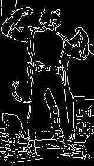
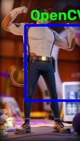
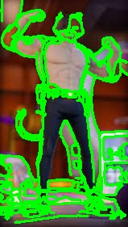

## El procesamiento de imagenes es fundamental en campos modernos como la IA, la vision artificial y la robotica. OpenCV, una potente biblioteca de codigo abierto, permite a los desarrolladores gestionar tareas complejas de procesamiento de imagenes con facilidad.

## imagen original

## imagen gris

## imagen redimencionada

## imagen rotada 90

## imagen borrosa

## imagen bordes

## dibujar rectangulo y añadir texto

## umbralizacion

## detectar contorns y dibujarlos
